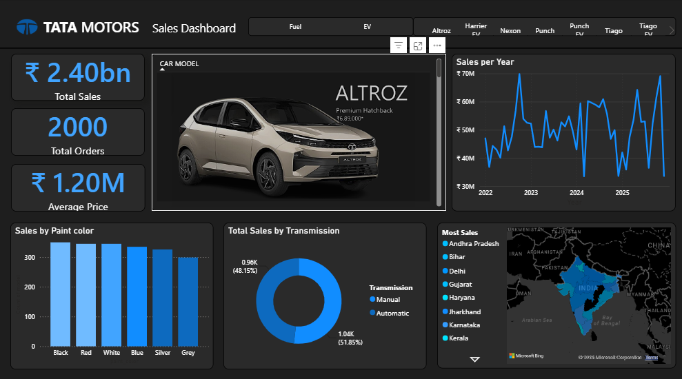
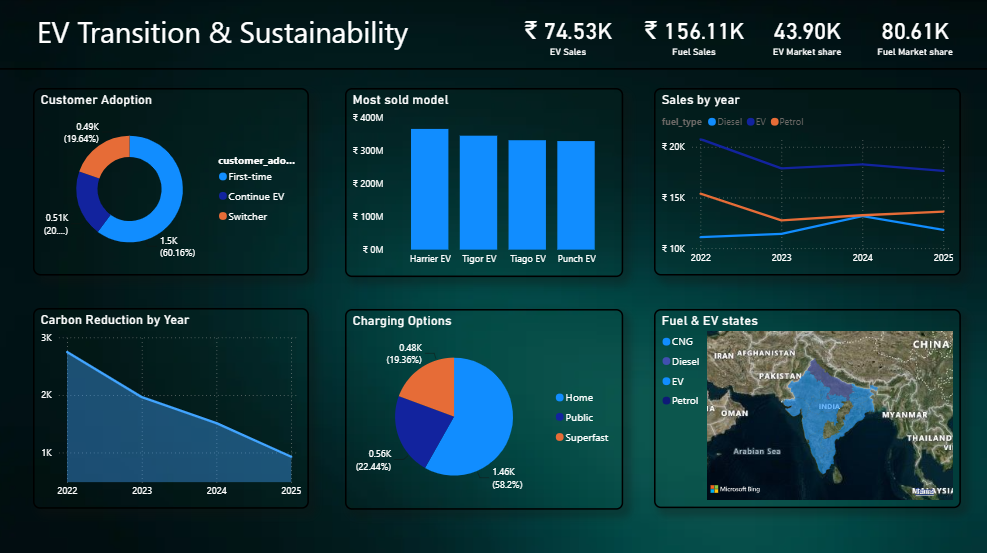
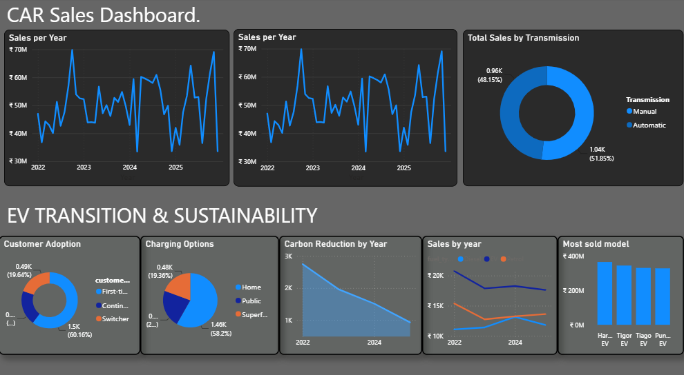

# 🚗 TATA Motors Sales, EV Transition & Sustainability Dashboard

> **Interactive Power BI Business Intelligence Project analyzing automotive sales, EV transition, customer adoption, and sustainability indicators.**

[](https://powerbi.microsoft.com/)
[](#)
[](#)
[](#)
[](#)

---

## 📌 Project Overview

This project presents an interactive **Microsoft Power BI dashboard for TATA Motors**, combining automotive sales analysis with **Electric Vehicle (EV) transition and sustainability analysis**.

The project transforms cleaned and preprocessed sales data into interactive visualizations that allow users to explore:

* Vehicle sales performance
* Year-wise sales trends
* Vehicle/model performance
* Geographic sales distribution
* Fuel and EV categories
* Customer EV adoption
* Charging options
* Carbon-reduction trends
* Most-sold models
* EV and fuel distribution across states

The project documentation confirms that the data was **cleaned and preprocessed** before dashboard development and that the main sales dashboard covers **4 fuel categories and 4 EV cars**. It also includes a dedicated **EV Transition and Sustainability dashboard**.

---

# 🎯 Project Objectives

The main objectives of this project are:

* Build an interactive Power BI dashboard for automotive sales analysis.
* Analyse sales trends across different years.
* Analyse vehicle and model-level performance.
* Understand geographical sales distribution.
* Compare represented fuel and EV categories.
* Analyse customer adoption of electric vehicles.
* Analyse charging-option distribution.
* Visualize carbon-reduction trends.
* Identify the most-sold vehicle/model.
* Connect automotive sales analysis with EV transition and sustainability.

---

# 📊 Dashboard Preview

## 1️⃣ TATA Motors Sales Dashboard

The Sales Dashboard provides an overall view of vehicle sales performance.

### Key visualizations

* Total Sales KPI cards
* Sales by Year
* Sales by Paint Colour
* Sales by State
* Fuel/Vehicle distribution
* Vehicle/Model details
* Interactive slicers and filters



---

## 2️⃣ EV Transition & Sustainability Dashboard

This dashboard focuses on the transition toward electric mobility and sustainability-related indicators.

### Key visualizations

* Customer Adoption
* Sales by Year
* Charging Options
* Carbon Reduction by Year
* Fuel & EV States
* Most Sold Model
* KPI cards



---

## 3️⃣ Additional Analytical View

The project also contains an additional analytical dashboard/view combining sales, EV transition and sustainability-related visualizations.

The view includes components such as:

* Sales by Year
* Customer Adoption
* Carbon Reduction
* Charging Options
* Fuel & EV States
* Most Sold Model



---

# 💼 Business Problem

Automotive sales data contains multiple dimensions such as:

* Time
* Vehicle model
* Fuel type
* EV category
* Customer adoption
* Geography
* Charging options
* Sustainability indicators

Analysing these dimensions separately can make it difficult to identify broader business trends.

This project addresses the problem by bringing these dimensions together into an interactive Power BI environment.

The dashboard allows users to move from **high-level sales performance** to **vehicle-level, geographical, EV-transition and sustainability analysis**.

---

# 🔎 Business Questions

## Sales Analysis

The dashboard helps answer:

* How are vehicle sales changing over time?
* Which vehicle/model categories contribute to sales?
* Which states have significant sales activity?
* What is the distribution across fuel/vehicle categories?
* How are sales distributed by paint colour?
* Which models are performing strongly?

## EV Transition

The dashboard helps investigate:

* What is the represented customer EV adoption pattern?
* How do EV-related sales change over time?
* What charging options are represented?
* Which states show EV/fuel activity?
* Which model is most sold?

## Sustainability

The dashboard provides a sustainability-oriented view through:

* Carbon reduction by year
* EV adoption
* EV/fuel geographic analysis
* Charging-option analysis

---

# 📈 Key Analytical Areas

| Analysis                | Purpose                                      |
| ----------------------- | -------------------------------------------- |
| **Sales Trend**         | Analyse sales changes over time              |
| **Vehicle Analysis**    | Compare model-level performance              |
| **Geographic Analysis** | Understand state-level distribution          |
| **Fuel Analysis**       | Analyse fuel/vehicle categories              |
| **EV Adoption**         | Understand customer adoption patterns        |
| **Charging Options**    | Analyse represented charging preferences     |
| **Carbon Reduction**    | Analyse the represented sustainability trend |
| **Most Sold Model**     | Identify leading model performance           |

---

# 🔄 Project Workflow

```text
                SOURCE DATA
                    │
                    ▼
          DATA CLEANING & PREPROCESSING
                    │
                    ▼
             DATA TRANSFORMATION
                    │
                    ▼
             POWER BI DATA MODEL
                    │
                    ▼
             DAX / CALCULATIONS
                    │
                    ▼
          INTERACTIVE VISUALIZATION
                    │
          ┌─────────┴─────────┐
          ▼                   ▼
   SALES DASHBOARD      EV TRANSITION &
                        SUSTAINABILITY
          │                   │
          └─────────┬─────────┘
                    ▼
             BUSINESS INSIGHTS
```

---

# 🧹 Data Preparation

The project data was **cleaned and preprocessed before dashboard development**.

The data preparation stage is intended to ensure that the dataset is suitable for analytical visualization.

The workflow includes:

1. Source data validation
2. Data cleaning
3. Data type preparation
4. Handling inconsistent records
5. Category standardization
6. Analytical data preparation
7. Validation before Power BI visualization

> **Note:** Exact row counts, column names, missing-value statistics and transformation details are intentionally not stated here because they are not available in the current project documentation.

Detailed transformation documentation can be maintained in:

```text
PowerQuery/Transformation_Steps.md
```

---

# 🧮 DAX & Calculations

Power BI/DAX calculations are used where required to support dashboard KPIs and analytical visualizations.

The repository contains a dedicated location for documenting measures:

```text
DAX/
└── Measures.md
```

Each documented measure should include:

* Measure name
* DAX formula
* Business definition
* Formatting
* Dashboard page
* Visuals using the measure

> Exact DAX formulas should be added from the final PBIX implementation rather than inferred from the dashboard visuals.

---

# 🌱 EV Transition & Sustainability

One of the main strengths of this project is that it extends beyond conventional sales reporting.

The project connects:

```text
Automotive Sales
       ↓
EV Customer Adoption
       ↓
Charging Options
       ↓
Geographic EV Distribution
       ↓
Carbon Reduction
       ↓
Sustainability Perspective
```

This provides a broader business intelligence view of automotive sales and the transition toward electric mobility.

The carbon-reduction visualization should be interpreted according to the underlying dataset's definition, baseline, units and assumptions.

---

# 💡 Business Value

The dashboard can support several types of analytical decision-making.

### Sales & Product Teams

Can use vehicle, model and geographic analysis to understand sales patterns.

### Marketing Teams

Can use customer adoption, geography and vehicle segmentation to understand market behaviour.

### EV Strategy Teams

Can use EV adoption, charging options and geographical distribution to study EV transition patterns.

### Sustainability Teams

Can use carbon-reduction indicators alongside EV analysis to understand the sustainability-oriented dimension of the project.

---

# 🛠️ Technologies Used

| Technology                       | Purpose                                   |
| -------------------------------- | ----------------------------------------- |
| **Microsoft Power BI**           | Dashboard development and visualization   |
| **Power Query**                  | Data cleaning and transformation          |
| **DAX**                          | Measures and analytical calculations      |
| **CSV / Excel / Source Dataset** | Data source                               |
| **Git & GitHub**                 | Version control and project documentation |

---

# 📁 Repository Structure

```text
TATA-Motors-Sales-EV-Sustainability-PowerBI/
│
├── 📄 README.md
├── 📄 PROJECT_STATUS.md
├── 📄 LICENSE
├── 📄 .gitignore
│
├── 📊 Dashboard/
│   ├── TATA_Motors_Sales_EV_Sustainability_Dashboard.pbix
│   └── README.md
│
├── 📂 Dataset/
│   ├── raw/
│   │   └── README.md
│   │
│   └── cleaned/
│       └── README.md
│
├── 📚 Documentation/
│   ├── Project_Overview.md
│   ├── Data_Dictionary.md
│   └── Business_Insights.md
│
├── 🧮 DAX/
│   └── Measures.md
│
├── 🔄 PowerQuery/
│   └── Transformation_Steps.md
│
├── 🖼️ Screenshots/
│   ├── sales-dashboard.png
│   ├── ev-transition-sustainability.png
│   └── additional-analysis.png
│
└── 📑 Reports/
    └── TATA_Motors_PowerBI_Project_Report.docx
```

---

# 📋 Project Documentation

Additional project documentation is available in the repository:

### Project Overview

```text
Documentation/Project_Overview.md
```

Contains the project's purpose, scope and analytical areas.

### Data Dictionary

```text
Documentation/Data_Dictionary.md
```

Contains the structure for documenting dataset fields and transformations.

### Business Insights

```text
Documentation/Business_Insights.md
```

Contains the structure for recording verified findings from the dashboard.

### DAX Measures

```text
DAX/Measures.md
```

Contains documentation for Power BI measures.

### Power Query

```text
PowerQuery/Transformation_Steps.md
```

Contains the structure for documenting data-cleaning and transformation steps.

### Project Report

```text
Reports/TATA_Motors_PowerBI_Project_Report.docx
```

Contains the detailed project report.

---

# 📌 Key Project Highlights

### 🚘 Automotive Sales Analytics

Interactive analysis of vehicle sales across:

* Time
* Vehicle/model
* State
* Paint colour
* Fuel/vehicle category

### ⚡ EV Transition

Dedicated analysis of:

* EV customer adoption
* EV sales trends
* Charging options
* EV/fuel geographic distribution
* Most-sold model

### 🌱 Sustainability

Sustainability-oriented analysis through:

* Carbon reduction by year
* EV transition
* Customer adoption
* Geographic EV analysis

### 📊 Interactive BI

The Power BI dashboard enables users to interact with the data through:

* Slicers
* Filters
* KPI cards
* Charts
* Maps
* Tables

---

# 🚀 Future Enhancements

The project can be extended with:

* [ ] Year-over-year sales growth
* [ ] Month-over-month analysis
* [ ] EV market/share analysis
* [ ] EV adoption growth rate
* [ ] Model-level drill-through pages
* [ ] State-level drill-down
* [ ] Revenue and profitability analysis
* [ ] Charging infrastructure analysis
* [ ] EV adoption forecasting
* [ ] Scenario analysis for future EV transition
* [ ] Automated Power BI data refresh
* [ ] Mobile-optimized dashboard
* [ ] Advanced sustainability metrics
* [ ] More detailed carbon-emission methodology

---

# ⚠️ Limitations

* The dashboard is based on the project's prepared dataset and should not be interpreted as an official TATA Motors corporate report.
* Exact source-data statistics are not documented in this repository until verified against the final dataset.
* Carbon-reduction metrics depend on the assumptions and methodology of the underlying data.
* Numerical business conclusions should be based on the final dashboard values and documented calculations.
* Dataset redistribution should only be performed if permitted by the source/license.

---

# 📜 Disclaimer

This project is an **educational and portfolio-oriented Business Intelligence project** created for data analysis and dashboard demonstration.

It is **not an official TATA Motors publication, financial report, investor presentation, or sustainability report**.

TATA Motors is referenced as the subject of the analysis. Any trademarks, brand names and related intellectual property belong to their respective owners.

---

# ⭐ GitHub Topics

Recommended repository topics:

```text
power-bi
powerbi-dashboard
data-analytics
business-intelligence
tata-motors
automotive-analytics
sales-dashboard
ev-analysis
electric-vehicles
sustainability
data-visualization
dax
power-query
```

---

# 👨‍💻 Project Category

**Business Intelligence | Data Analytics | Power BI | Automotive Analytics | EV Analysis | Sustainability**

### Core Skills Demonstrated

```text
Data Cleaning
      ↓
Data Transformation
      ↓
Business Intelligence
      ↓
Power BI Dashboard Design
      ↓
Data Visualization
      ↓
DAX
      ↓
Sales Analysis
      ↓
EV Transition Analysis
      ↓
Sustainability Analysis
      ↓
Business Storytelling
```

---

## ⭐ If you found this project useful

Feel free to explore the repository, review the dashboard implementation and use the project structure as a reference for Power BI analytics projects.

---
